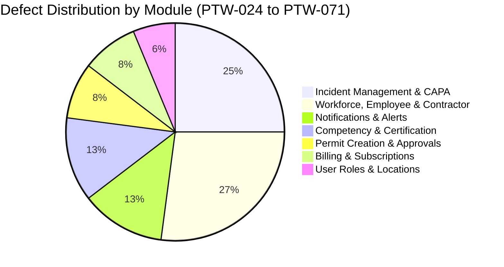
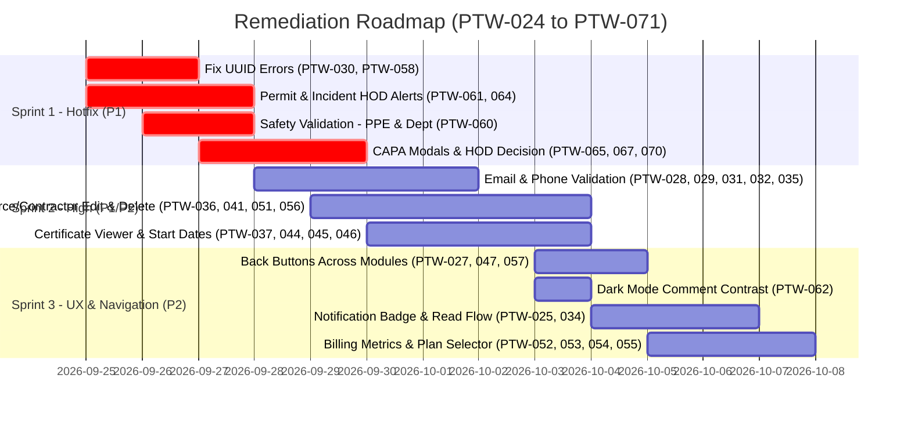

# PTW (Permit to Work) Application — Comprehensive QA Defect & Issue Log (PTW-024 to PTW-071)

**Document Version:** 2.0  
**Date:** September 24, 2026  
**Status:** Open / Active Triage  
**Application Under Test:** Permit to Work (PTW) Enterprise Web & Mobile Platform  
**Target Audience:** QA Engineers, Product Owners, Engineering Leads, Frontend & Backend Developers

---

## 1. Executive Summary

This defect tracking document provides a formal, comprehensive catalog of **48 additional defects and operational issues (PTW-024 through PTW-071)** identified during quality assurance audits and user acceptance testing of the **Permit to Work (PTW) Platform**.

These issues span critical operational modules including:
- **Notification Services & Alert Engine**
- **Permit Creation, Approval Workflows & HOD Decisioning**
- **Workforce Directory, Employee & Contractor Management**
- **Competency & Certification Tracking**
- **Location, Agency & User Role Management**
- **Billing, Subscription & License Metrics**
- **Incident Reporting, Investigation & Remediation (Root Cause, CAPA)**

---

## 2. Severity & Priority Classification Matrix

| Level | Definition | Target Resolution SLA |
| :--- | :--- | :--- |
| **Critical (P1)** | System crashes, unhandled backend exceptions, database/UUID syntax failures, broken access control, unhandled validation, or blocking key compliance & safety workflows. | Hotfix / 24–48 Hours |
| **High / Medium (P2)** | Core functionality failure, broken UI controls, missing navigation, lack of notifications for key stakeholders, or confusing UX with workarounds. | Current Sprint / 3–5 Days |
| **P1/P2** | Cross-impact bugs where core operational capability or access permissions depend on user role context. | High Priority Triage |

---

## 3. Defect Distribution & Module Breakdown

### Summary Breakdown Table
| Module Group | Issue IDs | Count | Primary Severity |
| :--- | :--- | :--- | :--- |
| **Incident Management & Investigation** | PTW-057, PTW-058, PTW-059, PTW-064, PTW-065, PTW-066, PTW-067, PTW-068, PTW-069, PTW-070, PTW-071 | 11 | P1 / P2 |
| **Workforce, Employee & Contractor Management** | PTW-027, PTW-028, PTW-029, PTW-030, PTW-031, PTW-032, PTW-033, PTW-035, PTW-036, PTW-040, PTW-041, PTW-051, PTW-056 | 13 | P1 / P2 |
| **Competencies & Certifications** | PTW-037, PTW-043, PTW-044, PTW-045, PTW-046, PTW-047, PTW-048, PTW-049, PTW-050 | 9 | P1 / P2 |
| **Notifications & System Alerts** | PTW-024, PTW-025, PTW-034, PTW-061, PTW-063, PTW-064 | 6 | P1 / P2 |
| **Permit Creation & Approval Workflows** | PTW-026, PTW-060, PTW-061, PTW-062 | 4 | P1 / P2 |
| **Billing & Subscription Management** | PTW-052, PTW-053, PTW-054, PTW-055 | 4 | P1 / P2 |
| **User Role, Permissions & Location** | PTW-038, PTW-039, PTW-042 | 3 | P1 / P2 |

---

## 4. Master Defect Tracking Register

| Defect ID | Module | Issue Summary | Expected Result | Priority | Status |
| :--- | :--- | :--- | :--- | :--- | :--- |
| **PTW-024** | Notifications | Opening a notification record results in a 404 error | The selected notification record should open successfully without a 404 error | **P1** | Open |
| **PTW-025** | Notifications | Opening a notification automatically marks it as Read | Notification should be marked as read only according to defined read/unread behavior | **P2** | Open |
| **PTW-026** | Platform Admin – Permit Creation | Platform Admin has Create Permit option, but clicking Next shows Access Denied | If option is displayed, Admin should be able to proceed or option should be hidden | **P1** | Open |
| **PTW-027** | Employee Management | Back button is missing in form/details view | A Back button should be available for clean navigation | **P2** | Open |
| **PTW-028** | Employee Management – Email | Email field accepts numerical-only values & allows invalid email | Strict RFC 5322 email regex validation must be enforced before submission | **P1** | Open |
| **PTW-029** | Employee Management – Phone | Phone field accepts alphabetic characters and allows creation | Phone field must accept valid phone digits only and reject alphabetic characters | **P1** | Open |
| **PTW-030** | Employee Management – Validation | Missing Department error displays raw SQL: `invalid input syntax for type uuid` | User-friendly message ("Please select a Department") must display instead of SQL error | **P1** | Open |
| **PTW-031** | Contractor Management | Contractor can be created without Email ID, Agency, and Department | Mandatory field validation must block submission until all required fields are filled | **P1** | Open |
| **PTW-032** | Contractor Management – Email | Email field accepts numerical-only values and allows invalid email | Strict email format validation must be enforced | **P1** | Open |
| **PTW-033** | Contractor Management – Name | Contractor Name field has no restriction on valid name input | Name field should enforce alphabetic/string character validation rules | **P2** | Open |
| **PTW-034** | Notifications | No notification count badge showing number of new/unread notifications | Top navigation and bell icon should display a live count/badge of unread items | **P2** | Open |
| **PTW-035** | Employee/Contractor/Agency – Phone | Phone number lacks predefined country code & 10-digit format restriction | Provide country code selector and enforce standard 10-digit phone format | **P2** | Open |
| **PTW-036** | Workforce Directory | Delete option is not available for workforce directory records | Authorized administrators should have a Delete/Soft-Delete option | **P1/P2** | Open |
| **PTW-037** | Certificate Management | Created certificate cannot be opened/viewed | Authorized users should be able to preview and view certificate documents | **P1** | Open |
| **PTW-038** | User Role Management | No notification sent after assigning a User Role | System should dispatch an email/app notification to the user upon role assignment | **P1/P2** | Open |
| **PTW-039** | User Role Management | Purpose and permissions of assigned role are not clearly communicated | Role details modal/tooltip should explain role capabilities and security scope | **P2** | Open |
| **PTW-040** | Workforce Directory | Phone number is not displayed in the Workforce Directory list | Workforce Directory table should include a contact phone column | **P2** | Open |
| **PTW-041** | Employee Management | Employee details cannot be edited after initial creation | Authorized users should be able to edit and update employee details | **P1/P2** | Open |
| **PTW-042** | Location Management | Location can be created without filling all required details | Form must validate and require all mandatory location fields prior to submission | **P1** | Open |
| **PTW-043** | Competencies – Workforce Member | Workforce Member dropdown does not display available members | Dropdown must populate active workforce members for competency linkage | **P1** | Open |
| **PTW-044** | Competencies – Certificate | Certificate is not displayed when selecting/opening a competency | Associated certificate details and attachment must be rendered correctly | **P1/P2** | Open |
| **PTW-045** | Certificate Management – Start Date | Certificate has Expiry Date but no Start / Issue Date field | Certificate model and form should capture both Start Date and Expiry Date | **P2** | Open |
| **PTW-046** | Certificate List | Certificate list table lacks Workforce Member and Expiry Date columns | Certificate table must display assigned Workforce Member name and Expiry Date | **P2** | Open |
| **PTW-047** | Certification | Back button is missing in certification workflow views | A standard Back/Cancel navigation button should be present | **P2** | Open |
| **PTW-048** | Competencies – Name/Description | Name and Description accept numerical-only input without validation | Name/Description should enforce valid character length and text formatting | **P2** | Open |
| **PTW-049** | Competencies – Validation | Incorrect/vague warning displayed when Workforce Member is not selected | Clear validation error: "Workforce Member selection is required" | **P1/P2** | Open |
| **PTW-050** | Workforce Management | Competency records do not have a Delete option; only Archive is available | Provide an explicit Delete option for competency records where permitted | **P2** | Open |
| **PTW-051** | Workforce Management | No clear Delete option available for complete workforce management records | Provide authorized users with Delete/Decommission capability | **P2** | Open |
| **PTW-052** | Billing | Quantity field allows record saving without entering a value | Quantity must be mandatory, positive integer, and validated before save | **P1/P2** | Open |
| **PTW-053** | Billing – Permit Metrics | Duplicate "Active Permit" metrics displayed with unclear meaning | Ensure each dashboard metric has a distinct KPI definition and label | **P2** | Open |
| **PTW-054** | Billing / Subscription | Usage information is displayed even though there is no active subscription | Usage counters should reflect actual subscription state and not show dummy stats | **P2** | Open |
| **PTW-055** | Subscription Management | Displays "Choose Plan", but underneath shows "No active plans available" | Available plans must load correctly, or an empty state CTA should guide the admin | **P1/P2** | Open |
| **PTW-056** | Contractor/Agency Management | Edit option unavailable for Employee, Contractor, and Agency records | Authorized users must be able to update phone, email, and metadata | **P1/P2** | Open |
| **PTW-057** | Incident Management | Back button is missing in the Incident module forms | A Back button should be present across all incident creation/view pages | **P2** | Open |
| **PTW-058** | Incident Management | Submitting incident shows error: `Validation failed – UUID is expired` | Incident must generate valid RFC-compliant UUIDs without unhandled expiration | **P1** | Open |
| **PTW-059** | Incident Management – Reporting | Clicking Report Incident without input lacks field-level validation | Display inline red validation errors for all required incident report fields | **P1** | Open |
| **PTW-060** | Permit Creation | Permit can be submitted without selecting Department and PPE items | Department and PPE selection must be strictly mandatory before permit submission | **P1** | Open |
| **PTW-061** | Permit Approval – HOD Notification | HOD does not receive notification when permit requires HOD approval | Backend must dispatch email/in-app alert to Department HOD upon permit submit | **P1** | Open |
| **PTW-062** | Permit Approval – Comments | In Dark Mode, typed text in approval comment field is invisible (black on dark) | Comment textarea text color must adhere to theme styling with high contrast | **P2** | Open |
| **PTW-063** | Platform Admin – Notifications | Platform Admin receives no notifications for permit creation or HOD approvals | System should dispatch configured event alerts to Platform Administrators | **P1/P2** | Open |
| **PTW-064** | Incident Approval – HOD Notification | HOD receives no notification when created incident requires approval | Backend trigger must notify designated HOD immediately upon incident filing | **P1** | Open |
| **PTW-065** | Incident – Root Cause | Clicking Root Cause does not open expected Create/Add modal | Open modal/drawer to allow investigators to record Root Cause analysis | **P1/P2** | Open |
| **PTW-066** | Incident – Corrective Action | After adding Corrective Action, no toast/confirmation is displayed | Provide success feedback and update table state immediately | **P2** | Open |
| **PTW-067** | Incident – Preventive Action | Preventive Action section lacks Add/Manage action button | Provide Add/Edit/Manage controls for Preventive Actions | **P1/P2** | Open |
| **PTW-068** | Incident – Action History | No Delete option available for Root Cause, Corrective, or Preventive items | Allow authorized investigators to delete/retract incorrectly entered items | **P2** | Open |
| **PTW-069** | Incident – Reminder | Reminder function lacks clear instructions and displays ambiguous context | Provide contextual labels, trigger frequency settings, and clear tooltips | **P2** | Open |
| **PTW-070** | Incident – HOD Decision | Incident shows "Pending HOD Decision" but HOD has no decision interface | Provide Approve / Reject / Request Info action bar for the authorized HOD | **P1** | Open |
| **PTW-071** | Incident Investigation | Root Cause, Corrective, & Preventive fields accept numerical-only input | Apply validation requiring meaningful textual descriptions (min length / format) | **P2** | Open |

---

## 5. Detailed Defect Analysis & Remediation Specifications

### Category A: Notifications & System Alerts (PTW-024, PTW-025, PTW-034, PTW-061, PTW-063, PTW-064)

#### PTW-024: Notification Record Deep-Link Returns HTTP 404
* **Severity/Priority:** Critical / P1
* **Component:** `NotificationList.vue` / `NotificationRoutes.ts`
* **Defect Description:** Clicking on an in-app notification item directs the user to an invalid route URL or queries a non-existent entity endpoint, returning a 404 Not Found error.
* **Root Cause:** Notification payloads store outdated route paths or target IDs without verifying entity route mapping (e.g., `/permits/:id` vs `/ptw/permit/:id`).
* **Remediation:** Implement a centralized Notification Resolver that validates entity existence and maps target notification types to authenticated routes.

#### PTW-025: Opening Notification Forcibly Mutates Read State
* **Severity/Priority:** Medium / P2
* **Component:** `NotificationItem.vue` / `notification.service.ts`
* **Defect Description:** Simply previewing or opening a notification immediately alters its status to Read without allowing user control or tracking whether the underlying action was resolved.
* **Remediation:** Introduce explicit read markers or ensure read state toggles only when the associated target resource is acknowledged.

#### PTW-034: Missing Unread Notification Counter / Badge
* **Severity/Priority:** Medium / P2
* **Component:** Header Navigation Bar / `Navbar.vue`
* **Defect Description:** The top navigation bar displays a static bell icon with no dynamic counter badge for unread notifications, forcing users to open the notification center to check for new alerts.
* **Remediation:** Implement a WebSocket/SSE or polling hook returning `unread_count` and render an interactive badge on the bell icon.

#### PTW-061 & PTW-064: Missing HOD Notifications for Permits & Incidents
* **Severity/Priority:** Critical / P1
* **Component:** `permitApprovalHook.ts` / `incidentWorkflowService.ts`
* **Defect Description:** When a permit or incident transitions to "Pending HOD Approval", no notification (email, push, or in-app) is dispatched to the designated Head of Department.
* **Remediation:** Add automated event dispatchers in the state machine transition hooks that query the department HOD's UUID and send immediate notifications.

#### PTW-063: Platform Admin Missing Event Notifications
* **Severity/Priority:** High / P1/P2
* **Component:** Event Notification Engine
* **Defect Description:** Platform administrators do not receive notifications for newly submitted permits or HOD approval completions.
* **Remediation:** Introduce a configurable notification subscription matrix allowing Platform Admins to subscribe to global organizational events.

---

### Category B: Workforce, Employee & Contractor Management (PTW-027–033, 035, 036, 040, 041, 051, 056)

#### PTW-028 & PTW-032: Email Accepts Numerical-Only Input Without RFC Validation
* **Severity/Priority:** Critical / P1
* **Component:** `EmployeeForm.vue` / `ContractorForm.vue` / Validation Schema
* **Defect Description:** Users can enter purely numeric strings (e.g., `1234567`) in the Email field, and the record saves successfully without throwing validation errors.
* **Remediation:** Apply strict regex validation: `^[a-zA-Z0-9._%+-]+@[a-zA-Z0-9.-]+\.[a-zA-Z]{2,}$` on both frontend client forms and backend DTOs.

#### PTW-029 & PTW-035: Phone Number Input Lacks Country Code & Enforces No 10-Digit Constraint
* **Severity/Priority:** Critical / P1 (PTW-029) & Medium / P2 (PTW-035)
* **Component:** `PhoneInput.vue` / Form Schemas
* **Defect Description:** The phone field accepts alphabetic characters (`"abcdef"`) and arbitrary lengths without an international country code dialer.
* **Remediation:** Integrate an international telephone input component (`libphonenumber`) restricting input to digits, enforcing 10-digit standard lengths with selected country codes (+91, +1, etc.).

#### PTW-030: Missing Department Throws Raw SQL Error: `invalid input syntax for type uuid`
* **Severity/Priority:** Critical / P1
* **Component:** `EmployeeController.ts` / PostgreSQL ORM
* **Defect Description:** Submitting an employee record without picking a department passes an empty string `""` to PostgreSQL's UUID column, causing a raw database crash message on the UI.
* **Remediation:** Add frontend schema validation `departmentId: z.string().uuid("Please select a valid Department")` and ensure backend transforms empty strings to nullable or rejects with HTTP 422 before querying the database.

#### PTW-031: Contractor Creation Permits Missing Mandatory Fields
* **Severity/Priority:** Critical / P1
* **Component:** `CreateContractorDialog.vue`
* **Defect Description:** A contractor record can be saved without Email ID, Agency, and Department.
* **Remediation:** Enforce mandatory field checks on frontend form submit and backend validation pipes (`@IsNotEmpty()` for `email`, `agencyId`, and `departmentId`).

#### PTW-036, PTW-041, PTW-051 & PTW-056: Inability to Edit or Delete Workforce / Contractor / Agency Records
* **Severity/Priority:** High / P1/P2
* **Component:** `WorkforceTable.vue` / API endpoints (`PATCH /api/workforce/:id`, `DELETE /api/workforce/:id`)
* **Defect Description:** No Edit or Delete action buttons exist in the directory tables, or the actions are disabled, preventing correction of typos, phone updates, or decommissioning personnel.
* **Remediation:** Enable action dropdowns with "Edit Details" (opening prepopulated modal) and "Decommission / Delete" (with confirmation dialog and audit log).

#### PTW-040: Phone Number Omitted from Workforce Directory Table
* **Severity/Priority:** Medium / P2
* **Component:** `WorkforceDirectoryList.vue`
* **Defect Description:** Emergency and operational supervisors cannot view contact numbers directly from the workforce list.
* **Remediation:** Add a "Contact Phone" column with clickable `tel:` links and country code formatting.

---

### Category C: Competencies & Certificate Management (PTW-037, PTW-043–050)

#### PTW-037 & PTW-044: Created Certificates & Competency Certificates Cannot Be Opened / Viewed
* **Severity/Priority:** Critical / P1
* **Component:** `CertificateViewerModal.vue` / Storage Service
* **Defect Description:** Clicking on a certificate in the Certificate Management or Competencies module fails to load or open the associated PDF/image document.
* **Remediation:** Verify S3/Cloud signed URL generation and implement a resilient PDF/Image preview modal with fallback download buttons.

#### PTW-043 & PTW-049: Competencies Dropdown Does Not Populate Workforce Members
* **Severity/Priority:** Critical / P1
* **Component:** `CompetencyAssignmentForm.vue`
* **Defect Description:** The Workforce Member select dropdown displays empty or throws an obscure validation warning when submitting.
* **Remediation:** Fix the API query fetching active workforce members for the current organization context and implement clear validation feedback.

#### PTW-045 & PTW-046: Certificate Missing Start Date & Omitted Metadata in Table
* **Severity/Priority:** Medium / P2
* **Component:** `CertificateSchema.prisma` / `CertificateList.vue`
* **Defect Description:** Certificates only store Expiry Date without an Issue/Start Date, and the main table does not display the member name or expiry date.
* **Remediation:** Update data model to include `startDate: DateTime`, add Start Date pickers, and update table headers to display `Workforce Member`, `Certificate Type`, `Issue Date`, and `Expiry Date`.

#### PTW-048 & PTW-071: Text Fields Accept Numerical-Only Garbage Data
* **Severity/Priority:** Medium / P2
* **Component:** Textarea & Input Fields across Competencies & Investigation
* **Defect Description:** Name and Description fields accept pure numbers (e.g., `9999999`) without validating meaningful text.
* **Remediation:** Implement custom validators requiring alphanumeric characters with a minimum length (e.g., min 3 chars for names, min 10 chars for descriptions).

---

### Category D: Billing & Subscription Management (PTW-052–055)

#### PTW-052: Billing Quantity Field Allows Blank / Null Submission
* **Severity/Priority:** High / P1/P2
* **Component:** `BillingItemModal.vue`
* **Defect Description:** The quantity input accepts empty values, causing corrupted invoice generation and NaN calculations.
* **Remediation:** Mark Quantity as required with `@Min(1)` validation and a default value of 1.

#### PTW-053: Duplicate "Active Permit" Metrics on Billing Dashboard
* **Severity/Priority:** Medium / P2
* **Component:** `BillingOverviewCards.vue`
* **Defect Description:** Two metric cards display identical or confusing "Active Permit" values.
* **Remediation:** Clarify metrics by renaming to "Permits Issued in Cycle" vs. "Currently Active / Open Permits" with distinct backend queries.

#### PTW-054 & PTW-055: Misleading Usage Metrics & "No Active Plans" Error State
* **Severity/Priority:** High / P1/P2
* **Component:** `SubscriptionPlanSelector.vue`
* **Defect Description:** Users without active subscriptions see mocked usage figures, and the plan selection screen shows "No active plans available".
* **Remediation:** Sync tier status with Stripe/billing provider; display inactive zero-state when unsubscribed; fix API plan fetching endpoint to return all active plans.

---

### Category E: Permit Creation & Approval UX (PTW-026, PTW-060, PTW-062)

#### PTW-026: Platform Admin Receives "Access Denied" When Clicking Next
* **Severity/Priority:** Critical / P1
* **Component:** `PermitWizard.vue` / RBAC Middleware
* **Defect Description:** Platform Admin has the Create Permit button, but stepping past Basic Info triggers HTTP 403 Access Denied.
* **Remediation:** Either grant Platform Admin explicit permit drafting privileges or conditionally hide the "Create Permit" button for administrative roles that lack site operational authority.

#### PTW-060: Permit Can Be Submitted Without Department & PPE Selection
* **Severity/Priority:** Critical / P1
* **Component:** `PermitCreationStep3.vue` / Safety Validation Pipe
* **Defect Description:** Major safety compliance breach: permits can bypass required PPE checklists and department selection.
* **Remediation:** Block form progression and submit actions until at least one PPE item is checked and a valid Department is selected.

#### PTW-062: Approval Comment Text Invisible in Dark Mode
* **Severity/Priority:** Medium / P2
* **Component:** `ApprovePermitModal.vue` / Theme CSS
* **Defect Description:** In Dark Mode, the textarea background is dark gray/black and text color defaults to black, rendering user input invisible while typing.
* **Remediation:** Apply CSS theme tokens: `color: var(--text-primary); background-color: var(--bg-surface);` ensuring high-contrast readability.

---

### Category F: Incident Management & Investigation (PTW-057–059, 065–070)

#### PTW-058: Incident Creation Fails with `Validation failed – UUID is expired`
* **Severity/Priority:** Critical / P1
* **Component:** `IncidentService.ts` / Token/ID Generator
* **Defect Description:** Creating an incident throws an unhandled error modal claiming the UUID has expired or failed validation.
* **Root Cause:** A temporary client-generated session token or stale cached identifier is erroneously passed into a database UUID field.
* **Remediation:** Use standard UUID v4 generation on the backend upon insertion, and eliminate passing expired client session keys into entity ID fields.

#### PTW-059: Report Incident Button Lacks Immediate Field-Level Highlighting
* **Severity/Priority:** Critical / P1
* **Component:** `IncidentReportForm.vue`
* **Defect Description:** Clicking submit on a blank incident form gives no visual cues or scrolls to invalid fields.
* **Remediation:** Trigger validation schema on submit, show inline error banners, and auto-focus the first invalid field.

#### PTW-065, PTW-066 & PTW-067: Broken Root Cause, Corrective & Preventive Action (CAPA) Popups & Controls
* **Severity/Priority:** Critical / P1 (PTW-065, 067) & Medium / P2 (PTW-066)
* **Component:** `IncidentInvestigationTab.vue` / `ActionModal.vue`
* **Defect Description:** Clicking Root Cause fails to open the creation dialog; Preventive Action has no add button; Corrective Action lacks completion confirmation.
* **Remediation:** Re-wire modal state controllers (`isRootCauseModalOpen`, `isPreventiveModalOpen`) and trigger standardized toast notifications upon action creation.

#### PTW-068: Inability to Delete Incorrect Investigation Action History
* **Severity/Priority:** Medium / P2
* **Component:** `IncidentHistoryTimeline.vue`
* **Defect Description:** Erroneous or typo-filled Root Cause/CAPA entries cannot be deleted by authorized safety investigators.
* **Remediation:** Add a delete action with audit logging (recording who removed the action and when).

#### PTW-069: Ambiguous Incident Reminder Functionality
* **Severity/Priority:** Medium / P2
* **Component:** `IncidentReminderCard.vue`
* **Defect Description:** The reminder box shows ambiguous data without indicating target recipients, trigger schedules, or delivery channels.
* **Remediation:** Redesign the Reminder component with explicit fields: "Reminder Date & Time", "Recipients (Assignee / HOD)", and "Reminder Notes".

#### PTW-070: Missing HOD Decisioning Interface for Pending Incidents
* **Severity/Priority:** Critical / P1
* **Component:** `IncidentDetailView.vue`
* **Defect Description:** Incidents display status "Pending HOD Decision", but the HOD views the record with no approval or decision action controls.
* **Remediation:** Render an authorized HOD Decision Action Bar containing:
  - **Approve Investigation & Close Incident**
  - **Reject / Reopen for Further Investigation** (with mandatory comments modal)

---

## 6. Implementation Action Plan & Sprint Allocation

---

## 7. Sign-off & Verification Checklist

- [ ] All P1 safety blockers (PTW-026, PTW-058, PTW-060, PTW-070) resolved and verified in Staging.
- [ ] End-to-end regression tests written for email/phone validation across Employee and Contractor creation.
- [ ] Notification dispatch confirmed for HOD permit approvals and incident filings.
- [ ] UI contrast tests performed in both Light Mode and Dark Mode.
- [ ] All navigation views verified to contain Back / Cancel buttons.
